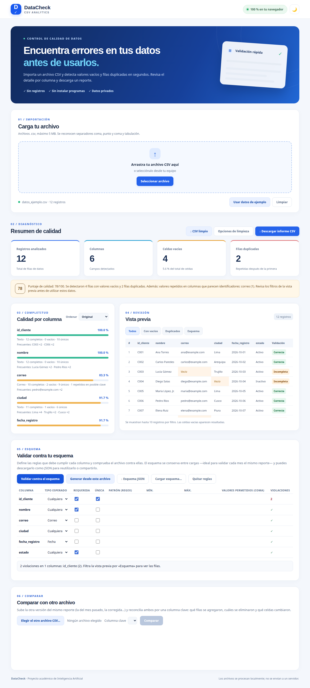
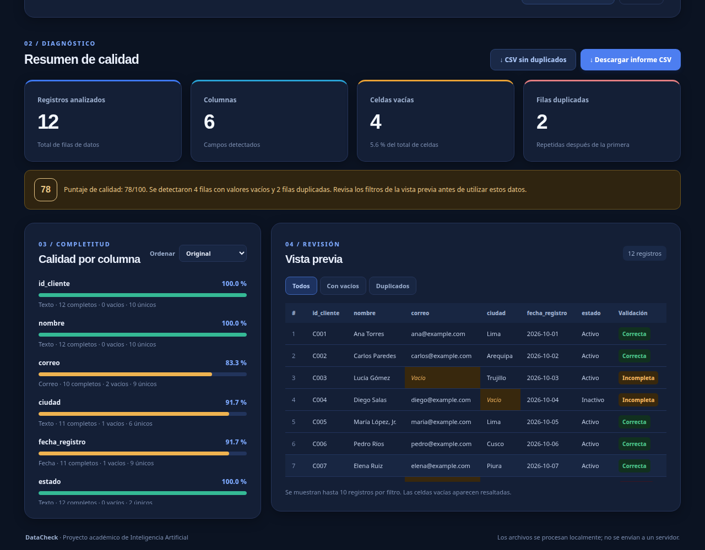

<div align="center">

# 🔍 DataCheck

### Encuentra errores en tus datos *antes* de usarlos

Importa un archivo CSV y detecta en segundos celdas vacías, filas duplicadas, tipos mezclados y otros problemas de calidad — **sin instalar nada y sin que tus datos salgan del navegador**.




*El archivo de ejemplo incluido, analizado: 12 registros, 4 celdas vacías, 2 filas duplicadas, puntaje 78/100.*

</div>

---

**Proyecto académico:** Examen Final · Inteligencia Artificial — Desarrollo de una aplicación con GitHub Copilot.

## Tabla de contenido

- [¿Qué es DataCheck?](#qué-es-datacheck)
- [Características](#características)
- [Comparación con otras herramientas](#comparación-con-otras-herramientas)
- [Capturas](#capturas)
- [Cómo ejecutarla](#cómo-ejecutarla)
- [Cómo usarla](#cómo-usarla)
- [Cómo interpretar los resultados](#cómo-interpretar-los-resultados)
- [Privacidad](#privacidad)
- [Límites y alcance](#límites-y-alcance)
- [Estructura del proyecto](#estructura-del-proyecto)
- [Pruebas](#pruebas)
- [Uso de GitHub Copilot](#uso-de-github-copilot)
- [Enlaces de la entrega](#enlaces-de-la-entrega)
- [Ideas futuras](#ideas-futuras)
- [Referencias](#referencias)

## ¿Qué es DataCheck?

En áreas administrativas y de análisis es habitual recibir reportes CSV para cargar o analizar. Si contienen celdas vacías, registros duplicados o columnas con tipos mezclados, cualquier indicador calculado después será incorrecto — y revisar esos problemas a mano en una hoja de cálculo consume tiempo y expone a errores humanos.

**DataCheck** automatiza esa primera revisión: abres la página, cargas el archivo y obtienes un diagnóstico completo con el detalle de dónde está cada problema. Todo el procesamiento ocurre en tu navegador; el archivo nunca se sube a un servidor.

**¿Para quién?** Analistas de datos, personal administrativo y estudiantes que necesitan validar un CSV antes de utilizarlo.

## Características

### 📊 Diagnóstico inmediato

- **Cuatro métricas clave**: registros analizados, columnas, celdas vacías (con su porcentaje sobre el total) y filas duplicadas.
- **Puntaje de calidad de 0 a 100** que resume el estado general del archivo (ver [cómo se calcula](#el-puntaje-de-calidad)).
- **Mensaje de diagnóstico** que resume los hallazgos y sugiere el siguiente paso.

### 🧪 Chequeos de calidad

| Chequeo | Qué detecta |
| --- | --- |
| Celdas vacías | Valores ausentes, globales y por columna. |
| Vacíos encubiertos | Valores como `N/A`, `null`, `sin dato` o `-` que fingen ser datos. Se cuentan aparte, sin mezclarlos con los vacíos reales. |
| Filas duplicadas | Filas idénticas a una anterior (la primera aparición nunca se marca). |
| Filas casi duplicadas | Filas iguales salvo mayúsculas/minúsculas o espacios internos — típico de cargas hechas dos veces con distinta prolijidad. |
| Filas irregulares | Filas con más o menos columnas que el encabezado. |
| Tipo por columna | Infiere si cada columna es de **números, fechas, correos, booleanos o texto**, y marca las celdas que no coinciden con el tipo dominante (incluidas fechas imposibles como `31/02/2026`, validadas contra el calendario real). |
| Avisos de encabezado | Encabezados duplicados (también si solo difieren en mayúsculas) o vacíos, que la app renombra para poder trabajar. |
| Estadísticas por columna | Media, mediana, mínimo y máximo en columnas numéricas; rango de fechas en las de fecha. |
| Valores atípicos | Números fuera del rango habitual de su columna (método del rango intercuartílico): el clásico «cero de más» en un importe. |
| Valores frecuentes | Los valores que más se repiten en cada columna, con su conteo. |
| Colisiones de clave | Valores repetidos en una columna casi única (≥ 90 % distintos) que parece un identificador: el mismo ID con datos distintos, que la fila duplicada entera no detecta. |
| Histograma | Mini-gráfico de distribución en las columnas numéricas: de un vistazo se ve si los importes se concentran o hay un grupo apartado. |
| Codificación dañada | Avisa si el archivo viene en Windows-1252 (típico de Excel; se interpreta correctamente) y cuenta celdas con mojibake, el texto dañado por doble codificación (`ñ` en vez de `ñ`). |
| Espacios en los bordes | Celdas con espacios al inicio o al final, una causa silenciosa de duplicados y cruces fallidos. |
| Valores únicos | Cuántos valores distintos tiene cada columna. |

### 📋 Detalle y revisión

- **Completitud por columna** con porcentaje y barra visual; se puede ordenar de **peor a mejor** para atacar primero lo más dañado.
- **Vista previa filtrable** (todos / con vacíos / duplicados) con **etiquetas por fila** que explican el estado de cada registro.
- **Delimitador detectado automáticamente**: coma, punto y coma o tabulación.

### 🧾 Esquema definido por el usuario

- **Tus reglas, no solo las genéricas**: por columna puedes exigir tipo esperado, que sea requerida, que sea única, un patrón (expresión regular), un rango mínimo/máximo o una lista de valores permitidos.
- **Violaciones visibles**: conteo por columna, resumen total, etiqueta «Esquema» en la vista previa y un filtro para ver solo las filas que no cumplen.
- **Reutilizable**: el esquema se conserva entre cargas (valida cada mes el mismo reporte), se puede **generar desde un archivo que está bien** para usarlo de plantilla, y descargarse o cargarse como **JSON**.

### 🔀 Comparación entre dos archivos (diff)

- **Reconciliación por columna clave**: sube la otra versión del mismo reporte y elige la clave (la app sugiere la columna más única); obtienes las filas **agregadas**, **eliminadas** y **modificadas**, con cada celda que cambió («antes» → «después»).
- **Informe de diferencias en CSV** para documentar qué cambió entre entregas.
- Las filas con clave vacía o repetida no se pueden reconciliar y se cuentan aparte, sin mezclarlas con el resultado.

### ⬇️ Exportación

- **Informe CSV** con los indicadores generales, el puntaje y las estadísticas por columna (incluido el tipo detectado), listo para adjuntar a una entrega o compartir con el equipo.
- **CSV limpio con corrección guiada**: copia sin filas duplicadas exactas y, solo si marcas las opciones, también sin casi duplicadas ni registros vacíos, con los pseudo-vacíos convertidos en celdas vacías y las fechas normalizadas a `AAAA-MM-DD`. Ninguna corrección se aplica en silencio.
- Ambas exportaciones **protegen las celdas que empiezan con `=`, `+`, `-`, `@`, `|` o `%`** para que no se ejecuten como fórmulas al abrirlas en una hoja de cálculo.

### 🎨 Experiencia

- **Tema claro y oscuro**: recuerda tu elección y, si no elegiste, sigue el tema de tu sistema (incluso si lo cambias con la página abierta).
- Animaciones sobrias (conteo de métricas y barras) que se desactivan si tu sistema pide *reducir movimiento*.
- Accesibilidad cuidada: foco de teclado siempre visible, contraste AA en ambos temas, estados anunciados para lectores de pantalla.
- Si una carga no es válida, verás un **error claro en español** y los resultados anteriores se limpian: nunca quedan mezclados datos de dos archivos.

## Comparación con otras herramientas

DataCheck no pretende reemplazar a las herramientas profesionales: ocupa el hueco de **validar un CSV en segundos, sin instalar nada, sin programar y sin que el archivo salga de tu equipo**. Así se ubica frente a las referencias del rubro (investigación de octubre de 2026; las herramientas web se verificaron en vivo):

| Herramienta | Dónde corre | Instalación | Tu archivo… | Su fuerte frente a DataCheck |
|---|---|---|---|---|
| **DataCheck** | Navegador, 100 % local | Ninguna | **Nunca sale de tu equipo** | — |
| **GoValidate.ai** | Navegador, 100 % local | Ninguna (comercial) | No sale del equipo | Diff con tolerancias y recibo auditable; editor de transformaciones con pasos registrados. Es de pago y de código cerrado. |
| **Arotip** | Navegador, 100 % local | Ninguna (gratis con límites) | No sale del equipo | Ahí nació la idea de las «ID collisions». Sin esquema de usuario ni estadísticas por columna (solo mín/máx/media); también cerrado. |
| **CSVLint** | Servicio web + CLI | Ninguna en la web | **Se sube a su servidor** | Esquemas Table Schema completos (el estándar Frictionless) y distintivo de validación incrustable. |
| **OpenRefine** | Escritorio (Java) | Sí | No sale del equipo | Limpieza profunda: *clustering* para unificar variantes («Lake Shasta» / «Shasta Lake»), transformaciones con expresiones e historial reutilizable. |
| **csvkit · qsv** | Terminal | Sí | No sale del equipo | Potencia y escala: SQL sobre el CSV, estadísticas avanzadas y archivos de gigabytes por *streaming*. Sin interfaz visual. |
| **ydata-profiling** | Librería Python | Sí (`pip`) | No sale del equipo | Informe exploratorio completo: correlaciones, alertas automáticas y comparación de datasets. Hay que programar. |
| **Great Expectations** | Librería Python | Sí (`pip`) | No sale del equipo | Validación profesional para pipelines: cientos de reglas declarativas versionables y documentación automática. Pesado para un chequeo simple. |

¿Y qué toma DataCheck de cada una? Las **estadísticas por columna** y el **esquema de usuario** vienen de CSVLint y csvkit; los **atípicos por IQR**, de qsv e ydata-profiling; las **colisiones de clave**, de Arotip; el **diff por clave**, de csv-diff y del Reconcile de GoValidate; y la **corrección solo con opciones marcadas**, de OpenRefine. La combinación que no ofrece ninguna otra de las verificadas en vivo: procesamiento local, código abierto, interfaz en español, puntaje explicado y esquema reutilizable entre cargas.

## Capturas

**Tema oscuro** — el mismo análisis, con la paleta nocturna:



En ambas capturas se aprecia el detalle por columna (tipo detectado, completitud, valores únicos) y la vista previa con las etiquetas *Correcta* e *Incompleta* y las celdas vacías resaltadas.

## Cómo ejecutarla

El sitio es estático: **no requiere base de datos, claves API ni backend**. Solo necesitas servir la carpeta con un servidor local.

> ⚠️ **No abras `index.html` con doble clic.** Por seguridad, los navegadores bloquean los módulos JavaScript cuando la página se abre como `file://`, y la aplicación no arrancará. Usa una de estas opciones:

**Opción A — VS Code + Live Server**

1. Abre esta carpeta (`Datacheck`) en VS Code.
2. Clic derecho sobre `index.html` → **Open with Live Server**.

**Opción B — Python**

Dentro de la carpeta del proyecto:

```bash
python -m http.server 5500
```

y abre [http://localhost:5500](http://localhost:5500) en tu navegador. (Equivalente con Node: `npx serve .`)

## Cómo usarla

1. **Carga un archivo**: arrástralo a la zona punteada, selecciónalo con el botón, o pulsa **Usar datos de ejemplo** para una demostración inmediata con los datos simulados incluidos.
2. **Lee el diagnóstico**: las cuatro métricas y el puntaje te dicen en un vistazo si el archivo es utilizable.
3. **Encuentra lo peor**: ordena el detalle por columna de peor a mejor completitud y revisa la nota de cada columna (tipo, vacíos, únicos).
4. **Inspecciona los registros**: filtra la vista previa por **Con vacíos** o **Duplicados** y fíjate en las etiquetas de cada fila.
5. **Exporta**: descarga el **informe CSV** para documentar el diagnóstico, o la **copia sin duplicados** para seguir trabajando con los datos limpios.
6. **Sigue con otro archivo**: pulsa **Limpiar** o carga uno nuevo; el análisis anterior se descarta por completo.

## Cómo interpretar los resultados

### El puntaje de calidad

```text
puntaje = 100 − % de celdas vacías − % de filas duplicadas      (entre 0 y 100)
```

Un 100 significa que no se encontraron vacíos ni duplicados. El puntaje es un resumen rápido, no un veredicto: un archivo puede puntuar alto y aun así tener casi duplicados o celdas de tipo distinto, que el detalle por columna y la vista previa sí muestran.

### Los tipos de columna

El tipo de una columna es el de la **mayoría de sus celdas clasificables**, siempre que represente al menos el **80 %**; si ningún tipo llega a ese umbral, la columna se marca **Mixto** y no se señalan diferencias. Las columnas de texto tampoco generan avisos. Los formatos numéricos aceptados incluyen los habituales en español e inglés (`1.234,56`, `1,234.56`, enteros y decimales simples), y las fechas se validan contra el calendario real (el 29/02 solo existe en años bisiestos).

### Las etiquetas de la vista previa

| Etiqueta | Significado |
| --- | --- |
| **Correcta** | La fila no presenta problemas. |
| **Incompleta** | Tiene al menos una celda vacía. |
| **Duplicada** | Es idéntica a una fila anterior. |
| **Casi duplicada** | Coincide con otra fila salvo mayúsculas o espacios internos. |
| **Irregular** | Tiene más o menos columnas que el encabezado. |
| **Tipo distinto** | Alguna celda no coincide con el tipo dominante de su columna. |
| **Atípico** | Tiene un valor numérico fuera del rango habitual de su columna. |
| *Vacío* (en la celda) | Esa celda está vacía y aparece resaltada. |

### Regla de duplicidad

Se considera duplicada una fila cuyos valores, después de quitar los espacios al inicio y al final de cada celda, son idénticos a los de una fila previa (respetando mayúsculas y minúsculas). Las líneas físicamente en blanco se omiten; en cambio, una fila con delimitadores y todas sus celdas vacías (por ejemplo `,,`) **sí cuenta** como un registro incompleto, igual que en cualquier lector CSV.

## Privacidad

- **Todo el análisis ocurre en tu navegador.** El contenido del CSV no se envía a ningún servidor, no se guarda y desaparece al cerrar o limpiar la página.
- La única conexión externa es la descarga de las fuentes tipográficas de Google Fonts, un recurso puramente visual: por ahí **no viaja** ninguna parte de tus datos.

## Límites y alcance

| Límite | Valor |
| --- | --- |
| Tamaño máximo del archivo | 5 MB |
| Filas de datos por archivo | 20 000 |
| Columnas por archivo | 200 |
| Delimitadores admitidos | `,` · `;` · tabulación |
| Vista previa | Hasta 10 filas por filtro (las estadísticas cubren el archivo completo) |

DataCheck no modifica tu archivo original (la copia sin duplicados es un archivo nuevo). El análisis cubre vacíos, duplicados, estructura, encabezados y tipos por columna; **no** evalúa reglas de negocio específicas (por ejemplo, que un correo pertenezca a un dominio concreto) ni consistencia de formatos más allá de los tipos detectados. Los datos del ejemplo son simulados y no representan clientes reales.

## Estructura del proyecto

```text
Datacheck/
├── index.html              Interfaz principal
├── styles.css              Estilos y temas (variables CSS)
├── src/
│   ├── app.js              Eventos, presentación y descargas
│   └── csv.js              Parser, análisis y exportación
├── tests/
│   ├── app.test.js         Pruebas de carga y presentación
│   └── csv.test.js         Pruebas de análisis y exportación
├── datos_ejemplo.csv       Datos simulados para probar
├── docs/
│   └── img/                Capturas usadas en este README
├── evidencias/             Capturas del trabajo con Copilot
├── .nojekyll
└── README.md
```

Sin dependencias ni paso de compilación: HTML, CSS y JavaScript con módulos ES, tal cual se sirven.

## Pruebas

La lógica y la carga de archivos cuentan con pruebas automáticas (Node 18+, sin instalar paquetes):

```bash
npm test
```

Son **45 pruebas** que cubren el parser (delimitadores, comillas, límites), cada chequeo de calidad, la inferencia de tipos, las exportaciones y el flujo de carga de la interfaz, incluidos los casos de error.

## Uso de GitHub Copilot

El examen requiere demostrar el **uso real** de GitHub Copilot para apoyar el desarrollo, además de explicar las decisiones tomadas. Las capturas de ese trabajo están en la carpeta [`evidencias/`](evidencias/) (`Copilot_01.png`, `Copilot_02.png`, …).

**Registro de aportes efectivamente realizados con Copilot:** _Pendiente de completar con tu experiencia y las modificaciones realizadas_.

## Enlaces de la entrega

- **Repositorio GitHub público:** _Pegar aquí el enlace creado_
- **Aplicación GitHub Pages:** _Pegar aquí el enlace publicado_
- **Video de demostración (máximo 1 min):** _Pegar aquí el enlace con permisos de visualización_

## Ideas futuras

- Detección de valores atípicos (*outliers*) en columnas numéricas.
- Consistencia de formatos por columna (por ejemplo, fechas mezcladas `DD/MM/AAAA` y `AAAA-MM-DD`).
- Aviso de codificación dudosa (caracteres dañados tipo `é` por UTF-8 mal interpretado).
- Detalle por fila con severidades en el informe descargable.

## Referencias

- Workshop indicado por el docente: https://github-samples.github.io/copilot-workshops/first-steps/copilot-app/
- GitHub Pages: https://docs.github.com/en/pages/getting-started-with-github-pages/configuring-a-publishing-source-for-your-github-pages-site
- GitHub Copilot en VS Code: https://code.visualstudio.com/docs/setup/copilot
